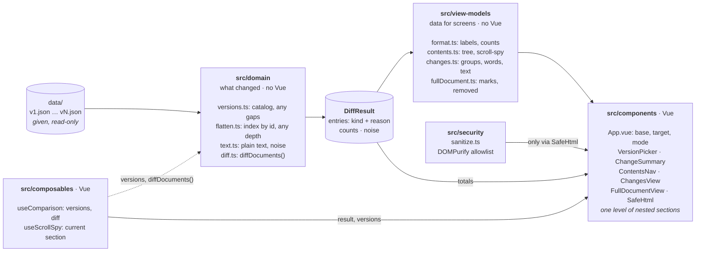

# Architecture

Status: written and approved in the plan phase, before any application code; decisions added as they were made.

## Problem and scope

A reader who checks the Team Handbook about once a quarter opens the app, picks the version they remember and the current one, and sees what changed. Reading only: no approve or sign-off actions. Works on a laptop screen, three local JSON snapshots, no backend.

Not designed on purpose: dozens of versions on screen, persistence, accounts, editing.

## Modules

Import direction: `components → view-models → domain`. ESLint checks every arrow (`eslint.config.ts`): `src/domain` and `src/security` import no Vue, composables, view-models or components; `src/view-models` import no Vue, composables or components; `src/components` import only types from `src/domain` and get data from `useComparison` and the view-models.

Trust boundary: paragraph text from `data/` is untrusted. It enters the DOM only as plain text (`plainText()` in the domain, used by the comparison and Changes only) or through `sanitizeHtml()` → `SafeHtml.vue` in Full document, never directly.

What each layer does:

- **domain** answers "what changed between two versions". It knows nothing about screens: an entry has a `kind` for counting and a typed `reason` (`renamed`, `field-removed`, …), never display text. It handles any number of versions with gaps and sections nested to any depth.
- **view-models** are plain functions that turn one `DiffResult` into what a screen needs, in four modules by screen area: labels and section counts, the Contents tree and scroll-spy maths, Changes only groups and paragraph text, Full document marks and removed notes. A new screen adds a view-model; the domain stays.
- **composables** are the UI's only way into the domain (`useComparison`) and the DOM side of scroll tracking (`useScrollSpy`).
- **components** render view-model output. State is three refs in `App.vue`. The screens show one level of nested sections, as in the data; deeper nesting is compared correctly but not rendered yet.

## Decisions

| Decision | Alternatives | Why |
| --- | --- | --- |
| Match nodes by `id` | Match by text similarity | The reviewer said ids are identities. Similarity only as a later "possibly renamed" hint |
| One change per clause | One change per field or per paragraph | The reader thinks in rules; per-field counts would inflate small edits |
| Compare plain text; Changes only shows plain text, Full document renders sanitized HTML | Compare raw markup; render plain text everywhere | Markup-only edits become noise, links stay usable in the full document, and no XSS |
| Show field and paragraph values exactly as in the data | Append units or reformat dates | The app must not invent content; "25" stays "25" |
| Two views (Changes only, Full document) from one `DiffResult` | Side-by-side columns | Side-by-side is cramped on a laptop and reads poorly for long rules |
| Hide reorder inside a parent and formatting-only noise | Show everything | The reviewer allowed hiding both; neither is a content change. Hidden noise is still counted for one muted line |
| State in three refs in `App.vue` | Pinia, Vue Router | Nothing else needs the state; there are no pages to route |
| Three layers: domain, view-models, components; ESLint guards the imports | Logic inside components and composables | The diff and every screen's data are plain functions tested in milliseconds; a new screen adds a view-model without touching the diff |
| Typed `reason` on each entry, display text in one map (`format.ts`) | Display labels such as "Field removed" as data the UI branches on | A typo in a string would compile; TypeScript checks every reason, and the words live in one place |
| Load versions with `import.meta.glob`, sorted by the `version` field | Hard-coded imports, `version - 1` lookups | Gaps in numbering and dozens of versions later do not break the design |
| No comparison-result cache | A `Map` keyed by `"base:target"` | A Vue `computed` around the pure `diffDocuments(base, target)` is enough for three snapshots in memory, and for dozens. The cache is a one-line wrapper later if profiling ever asks for it |
| Intra-parent reorder detection is a linear pass (arrays and sets) | A nested walk of one sibling list inside another | Linear in the number of children, simple to test |
| Domain text helpers use browser APIs (`DOMParser`, DOMPurify on `window`) | A second parser for Node | One parser for the browser app. A Node or server-side run would need jsdom or a server-side sanitizer; listed in Trade-offs |
| No JSON schema validation or duplicate-id checks | Validate every file on load | The fixtures are given and well-formed. Validation is a Not done item |
| No loader, skeleton or error screen; only an empty state when a pair has no differences | Skeleton on every pair switch, a global error page | Versions are bundled at build time (`import.meta.glob`, eager), so nothing is fetched and a skeleton would only flash. Loading, error and Retry states with request cancellation come with the first remote data source |
| Husky pre-commit hook running `npm run check` | lint-staged on staged files only; CI | The whole check takes seconds, so checking staged files only adds a dependency without saving time. CI is a Not done item |
| Links in Full document open in a new tab (`target="_blank"`, `rel="noopener noreferrer"`) | Same tab | Following a link must not replace the comparison and the chosen pair; `rel` blocks tabnabbing |
| Contents highlight follows scrolling (`aria-current="location"`) | Highlight only the clicked link | After a manual scroll a fixed highlight would point at the wrong section. The choice is a pure function (`pickActive`) with tests |
| Reading line at 64px that slides down over the last screen; a jump holds its link until the reader scrolls 48px | "Last link at the bottom of the page" rule; extra empty space at the end; a timer-based lock | Every section lights up in order, short final sections included, and the document keeps its natural length. Tested by step-scrolling at 700 to 1400px windows and on a short page |
| On narrow screens Contents is a `
` bar pinned to the top; choosing a section jumps and closes it | A "Jump to section" select above the document | A select scrolls away with the page; the pinned bar stays reachable and shows where the reader is. The scroll spy takes the bar's bottom edge as a parameter instead of looking up a CSS class |
